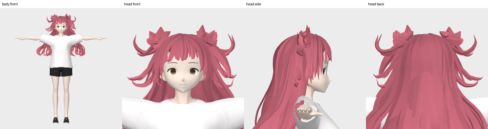

# ComfyUI-HairDeck

[简体中文](README.md) | **English**

Three native ComfyUI nodes: **Model Loader → Generate Hair → Save Outputs**.
Generate stylized hair cards and spring bones from a single character image, then export GLB, VRM, and animation previews from one output node.

**Inference runs directly in ComfyUI's Python/CUDA process. No HairDeck web app, WSL, HTTP inference service, or machine-specific paths are required.**
VRM export uses the portable Blender prepared by the installer. Image and animation previews use rendering code included with this plugin.



[Full resources — Quark Drive](https://pan.quark.cn/s/cfe2401c29aa) ·
[GitHub plugin releases](https://github.com/FengLairh/ComfyUI-HairDeck/releases/latest) ·
[Official models](#official-models) · [Complete example workflow](example_workflows/03_完整示例_全流程.json) · [Validation](VALIDATION.md)

## Installation

1. Download a release and place its `ComfyUI-HairDeck` folder in `ComfyUI/custom_nodes/`, or run this command from that directory:

```bash
git clone https://github.com/FengLairh/ComfyUI-HairDeck.git
```

2. Install dependencies with **ComfyUI's own Python**, keeping its existing CUDA PyTorch/torchvision installation:

```bash
python -m pip install -r custom_nodes/ComfyUI-HairDeck/requirements.txt
```

On Windows portable installations, replace `python` with your `python_embeded/python.exe` or the Python executable provided by your launcher.

3. Download the models and optional VRM export tools. Run this command from the `ComfyUI` directory:

```bash
python custom_nodes/ComfyUI-HairDeck/install_models.py --models-dir models/hairdeck --with-blender
```

For the official Windows portable distribution, run the following from the parent directory containing `python_embeded` and `ComfyUI`:

```powershell
.\python_embeded\python.exe -m pip install -r .\ComfyUI\custom_nodes\ComfyUI-HairDeck\requirements.txt
.\python_embeded\python.exe .\ComfyUI\custom_nodes\ComfyUI-HairDeck\install_models.py --models-dir .\ComfyUI\models\hairdeck --with-blender
```

Downloads use pinned revisions and SHA-256 verification, with resumable chunked downloads.
Downloads occur only when you explicitly run the installer; importing nodes and executing workflows do not download models automatically.
Omit `--with-blender` if you only need static GLB output.

To reuse an existing compatible model directory, configure it using `extra_model_paths.yaml.example`.
The complete model directory requires several GB; portable Blender needs additional disk space.

```text
ComfyUI/models/hairdeck/
├── ckpt/{card_vae,image_model,chain_model}/
├── data/{avatar,spring}/ ...
├── third_party/weights/{sam3,dinov3,birefnet_matting}/
└── tools/blender/               # Portable Blender and add-on for VRM export
```

Restart ComfyUI after installation. The three nodes appear under **HairDeck**.

<a id="official-models"></a>

## Official model downloads

The plugin requires six models, totaling approximately **6.4 GB** of weights.
The plugin release ZIP does not include these weights.
All destination paths below are relative to `ComfyUI/models/hairdeck/`.

| Model | Official source | Weight file | Destination |
|---|---|---|---|
| HairDeck hair-card VAE | [hyz317/HairDeck — card_vae](https://huggingface.co/hyz317/HairDeck/tree/main/ckpt/card_vae) | `model.safetensors` | `ckpt/card_vae/` |
| HairDeck image-to-hair model | [hyz317/HairDeck — image_model](https://huggingface.co/hyz317/HairDeck/tree/main/ckpt/image_model) | `model.safetensors` | `ckpt/image_model/` |
| HairDeck spring-bone model | [hyz317/HairDeck — chain_model](https://huggingface.co/hyz317/HairDeck/tree/main/ckpt/chain_model) | `model.safetensors` | `ckpt/chain_model/` |
| SAM 3 | [facebook/sam3](https://huggingface.co/facebook/sam3) | `sam3.pt` | `third_party/weights/sam3/` |
| DINOv3 ViT-L/16 | [facebook/dinov3-vitl16-pretrain-lvd1689m](https://huggingface.co/facebook/dinov3-vitl16-pretrain-lvd1689m) | `model.safetensors` | `third_party/weights/dinov3/` |
| BiRefNet matting | [ZhengPeng7/BiRefNet-matting](https://huggingface.co/ZhengPeng7/BiRefNet-matting) | `model.safetensors` | `third_party/weights/birefnet_matting/` |

**Companion data is also required.** Obtain the following from the [official HairDeck model repository](https://huggingface.co/hyz317/HairDeck):

- `ckpt/card_vae/stats.json` and `ckpt/card_vae/latent_stats_head.json`.
- `data/token_stats_head.json`, `data/head_frame_train.npz`, and `data/spring/chain_stats_head.json`.
- For VRM export or animation previews, the avatar and configuration files in [data/avatar/](https://huggingface.co/hyz317/HairDeck/tree/main/data/avatar).

The official SAM 3 and DINOv3 Hugging Face repositories require login and access approval/license acceptance as specified on their repository pages.
The current installer downloads these two weights from the following ModelScope mirrors; the other models come from the official Hugging Face repositories listed above.
All downloads use pinned revisions and SHA-256 verification:

- [SAM 3 ModelScope mirror](https://modelscope.cn/models/facebook/sam3/files)
- [DINOv3 ModelScope mirror](https://modelscope.cn/models/facebook/dinov3-vitl16-pretrain-lvd1689m)

Use the installer to download weights and companion data together and avoid missing files during manual setup.
See the [upstream HairDeck project](https://github.com/hyz317/HairDeck#model-weights) for the original installation and model documentation.

### Offline model bundle

Full resource download: [Quark Drive](https://pan.quark.cn/s/cfe2401c29aa). Installation locations for the model and tool bundles are described below.

`HairDeck-Models-v0.1.1.zip` contains all six weights, statistics, example avatar data, and licenses.
The model bundle is distributed separately; this code repository does not host model weights.
If you do not have the offline bundle, use the installer above to download the required files from their sources.

Extract the archive into `ComfyUI/models/` to create the standard `hairdeck` directory, then verify it with ComfyUI's Python:

```bash
python models/hairdeck/verify_models.py models/hairdeck
```

After verification succeeds, select `auto` in the Model Loader node. No online model download is needed for this setup.
The bundle excludes caches, logs, generated outputs, and user configuration.

The optional Windows VRM export tools are distributed as `HairDeck-Windows-VRM-Tools-v0.1.1.zip`.
Extract this archive into `ComfyUI/models/` as well, then run the following command to unpack Blender from its local archive and enable its add-on:

```bash
python custom_nodes/ComfyUI-HairDeck/install_models.py --models-dir models/hairdeck --only-blender
```

To build the same bundles from an existing complete model directory:

```bash
python custom_nodes/ComfyUI-HairDeck/scripts/build_model_bundle.py --source models/hairdeck --output-dir model_bundles --windows-tools
```

The builder checks the source files against the published SHA-256 hashes, creates ZIP64 archives, per-file manifests, and archive checksums, then reads every archived file back to verify it.
Model archives are distributed separately from the code repository.

## Three nodes

| Node | Inputs and purpose |
|---|---|
| ① Model Loader (模型加载) | Select the model bundle; ComfyUI ModelPatcher manages all six models |
| ② Generate Hair (生成头发) | Upload/select an image inside the node, set the seed, steps, and guidance strength; preprocessing, hair cards, and optional spring bones run internally |
| ③ Save Outputs (输出保存) | Choose `GLB`, `GLB + VRM`, or `GLB + VRM + 动画` (animation); save to one result folder with previews, video playback, and download links |

Each default example workflow contains exactly three nodes. Image upload is built in, so no additional LoadImage, preprocessing, or export nodes are needed.
Advanced inputs accept external IMAGE/MASK connections. The GLB output retains the standard `FILE_3D_GLB` type and can optionally connect to the built-in Preview3D node.

Show bone lines (显示骨骼线) controls geometry/animation visualization. Skinning and spring-bone properties are stored in the VRM.
VRM export uses the upstream example avatar by default and also supports the custom head profiles described below. Fitting complete custom avatars is not yet supported.

Enable Generate spring bones (生成弹簧骨骼) in the generation node before saving VRM or animation output. You can disable it for static GLB output.
For the transparency MASK, 1 means transparent and 0 means retained; when no mask is connected, the uploaded image's alpha channel is used.
The nodes process one image at a time. Use the ComfyUI queue and seed increments for multiple generations.

### Custom base heads

Run this command from `ComfyUI` using its Python to import an FBX. Portable Blender and its VRM add-on must already be installed:

```bash
python custom_nodes/ComfyUI-HairDeck/scripts/import_head.py "path/to/MyHead.fbx" --models-dir models/hairdeck --name MyHead --make-default
```

Refresh ComfyUI, select `auto` or `MyHead` in Base Head (基础头模) on the output node, and enable GLB reference head (GLB 包含参考头模).
`auto` uses the locally configured default; `upstream` uses the original reference head. The workflow still has three nodes, and switching heads reuses generated hair.

The importer applies uniform scale and translation to the training head frame, retains mesh geometry and UVs, and creates a gray reference head plus a head-only VRM profile rigidly bound to the reference avatar's head bone.
GLB, VRM, and animation use the same head. Generation uses the character image; the selected head is used for output assembly and previews. Spring collisions use the existing approximate colliders.
Use `--scale-adjust` and `--offset X Y Z` for scale and head-frame position adjustments. Use a new profile name when reimporting; existing profiles are not overwritten.

Assets are stored in `models/hairdeck/heads/MyHead/`; `heads/active.json` records the local default.
FBX and converted assets retain their source permissions and are stored separately in the model directory. The plugin source archive includes only the generic importer. No model weights need to be downloaded again.

## Example workflows

Drag [01_静态发片_GLB.json](example_workflows/01_静态发片_GLB.json) or [02_弹簧骨骼_VRM_动画.json](example_workflows/02_弹簧骨骼_VRM_动画.json) into ComfyUI.
Upload/select your character image in the Generate Hair (生成头发) node, then run the workflow.

All three templates contain exactly three nodes, with presets for static GLB, VRM, or complete output including animation.
The output node provides model views, an animation preview, file downloads, and optional input images, masks, and curve data.
When submitting an example with `scripts/generate_full_example.py`, saved PNGs embed the three-node workflow and can be dragged into ComfyUI to restore it.

Use an image with a clear head and the full hairstyle visible. Start with one generation and 50 steps, then adjust the seed and output options.
Changing the seed reuses preprocessed image data from ComfyUI's temporary directory.
Changing the output format, color, or reference-head option reuses the generated result.
The preprocessing cache stores CPU image data and does not retain extra GPU features; changing the image or models invalidates the cache.

Results are saved under ComfyUI's `output/HairDeck/`; temporary export data is stored in `temp/hairdeck/`.
Each save creates a separate result folder without overwriting previous results.
Cancellation takes effect after the current processing stage finishes.

### Upgrading from 0.1

v0.2 replaces the seven-node workflow with a three-node interface. The former standalone preprocessing, bone, and export nodes are no longer registered.
Restart and refresh ComfyUI, then import the new templates. Previous templates remain available in the [v0.1.1 release](https://github.com/FengLairh/ComfyUI-HairDeck/releases/tag/v0.1.1).
Existing models do not need to be downloaded again; the v0.1.1 offline model bundle remains compatible with v0.2.

v0.2.1 fixes the Q/K/V dtype mismatch with xFormers. To upgrade from v0.2.0, update the plugin and restart ComfyUI; no model download is required.

## Requirements and validation

- ComfyUI **0.30.0 or later**, Python 3.12+, and a CUDA build of PyTorch 2.8+.
- A BF16-capable NVIDIA CUDA GPU is required. A 16 GB GPU has been tested successfully; 12 GB is only a configuration reference and has not been tested. 8 GB configurations are untested.
- Native Windows workflows have been tested with Python 3.12.10, PyTorch 2.8.0+cu129, and an RTX 5060 Ti 16 GB.
- v0.2.1 also passed the previously failing complete workflow on ComfyUI 0.43.0, PyTorch 2.9.1+cu130, xFormers 0.0.33.post2, and an RTX 3090 24 GB.
- Linux x86-64 paths and tool installation are implemented, but native Linux ComfyUI has not been tested on hardware.
- Other attention backends, GPUs, and Python versions have not been individually validated. See [VALIDATION.md](VALIDATION.md) for the tested scope, including pending browser visual acceptance.

SAM 3 imports Triton modules. Windows dependencies use `triton-windows`; Linux uses `triton`.
The tested Windows combination is triton-windows 3.4.0.post21 with PyTorch 2.8. The nodes do not enable SAM 3's torch.compile.

## Distribution and licenses

Source distributions include `pyproject.toml`, dependencies, example workflows, and third-party licenses.
The plugin ZIP excludes model weights, Blender binaries, local configuration, logs, and access tokens.
ComfyRegistry registration requires your own `PublisherId` and repository URL; the upstream author's identity is not used as a default.

The algorithms and models come from [HairDeck](https://github.com/hyz317/HairDeck).
The original HairDeck code and this adapter use Apache-2.0. SAM 3, DINOv3, BiRefNet, pyrender, and other third-party materials retain their respective licenses; see [THIRD_PARTY_NOTICES.md](THIRD_PARTY_NOTICES.md).
