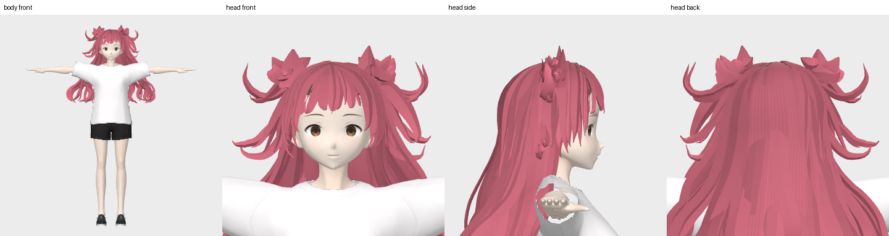

# ComfyUI-HairDeck

**简体中文** | [English](README.en.md)

三个原生 ComfyUI 节点：**模型加载 → 生成头发 → 输出保存**。
从单张角色图片生成风格化发片、弹簧骨骼，集中导出 GLB / VRM 和动画。

**推理直接运行在 ComfyUI 的 Python/CUDA 进程中。无需 HairDeck 网页、WSL、HTTP 推理服务或本机固定路径。**
VRM 导出使用安装脚本准备的便携版 Blender；动画与图片预览使用随插件提供的渲染代码。



[完整资源下载（夸克网盘）](https://pan.quark.cn/s/cfe2401c29aa) ·
[GitHub 插件发布包](https://github.com/FengLairh/ComfyUI-HairDeck/releases/latest) ·
[官方模型地址](#official-models) · [完整示例工作流](example_workflows/03_完整示例_全流程.json) · [验证范围](VALIDATION.md)

## 安装

1. 下载发布包并将其中的 `ComfyUI-HairDeck` 文件夹放到 `ComfyUI/custom_nodes/`，或在该目录执行：

```bash
git clone https://github.com/FengLairh/ComfyUI-HairDeck.git
```

2. 使用 **ComfyUI 自己的 Python** 安装依赖；保留 ComfyUI 已有的 CUDA PyTorch/torchvision：

```bash
python -m pip install -r custom_nodes/ComfyUI-HairDeck/requirements.txt
```

Windows 便携版通常需要将 `python` 替换成自己的 `python_embeded/python.exe` 或启动器附带的 Python 路径。
以下命令的工作目录为 `ComfyUI`：

```bash
python custom_nodes/ComfyUI-HairDeck/install_models.py --models-dir models/hairdeck --with-blender
```

例如，官方 Windows 便携版可在包含 `python_embeded` 和 `ComfyUI` 的上级目录运行：

```powershell
.\python_embeded\python.exe -m pip install -r .\ComfyUI\custom_nodes\ComfyUI-HairDeck\requirements.txt
.\python_embeded\python.exe .\ComfyUI\custom_nodes\ComfyUI-HairDeck\install_models.py --models-dir .\ComfyUI\models\hairdeck --with-blender
```

下载按固定版本和 SHA-256 校验，支持分段续传。下载只在明确运行安装脚本时发生；导入节点和执行工作流不会自动下载。
只使用静态 GLB 时可省略 `--with-blender`。

已有兼容模型包可通过 `extra_model_paths.yaml.example` 配置，无需重复复制模型。
完整模型目录约需数 GB，便携 Blender 另需磁盘空间。

```text
ComfyUI/models/hairdeck/
├── ckpt/{card_vae,image_model,chain_model}/
├── data/{avatar,spring}/ ...
├── third_party/weights/{sam3,dinov3,birefnet_matting}/
└── tools/blender/               # VRM 导出用便携 Blender 与插件
```

安装完成后重启 ComfyUI，在菜单 **HairDeck** 中找到三个节点。

<a id="official-models"></a>

## 官方模型下载地址

本插件需要以下六个模型，权重合计约 **6.4GB**。插件发布 ZIP 不包含这些权重。
表中的存放位置均相对于 `ComfyUI/models/hairdeck/`。

| 模型 | 官方来源 | 权重文件 | 存放位置 |
|---|---|---|---|
| HairDeck 发片 VAE | [hyz317/HairDeck — card_vae](https://huggingface.co/hyz317/HairDeck/tree/main/ckpt/card_vae) | `model.safetensors` | `ckpt/card_vae/` |
| HairDeck 图像发片生成模型 | [hyz317/HairDeck — image_model](https://huggingface.co/hyz317/HairDeck/tree/main/ckpt/image_model) | `model.safetensors` | `ckpt/image_model/` |
| HairDeck 弹簧骨骼生成模型 | [hyz317/HairDeck — chain_model](https://huggingface.co/hyz317/HairDeck/tree/main/ckpt/chain_model) | `model.safetensors` | `ckpt/chain_model/` |
| SAM 3 | [facebook/sam3](https://huggingface.co/facebook/sam3) | `sam3.pt` | `third_party/weights/sam3/` |
| DINOv3 ViT-L/16 | [facebook/dinov3-vitl16-pretrain-lvd1689m](https://huggingface.co/facebook/dinov3-vitl16-pretrain-lvd1689m) | `model.safetensors` | `third_party/weights/dinov3/` |
| BiRefNet matting | [ZhengPeng7/BiRefNet-matting](https://huggingface.co/ZhengPeng7/BiRefNet-matting) | `model.safetensors` | `third_party/weights/birefnet_matting/` |

**配套数据也需要下载。** 在 [HairDeck 官方模型仓库](https://huggingface.co/hyz317/HairDeck) 中获取：

- `ckpt/card_vae/stats.json`、`ckpt/card_vae/latent_stats_head.json`。
- `data/token_stats_head.json`、`data/head_frame_train.npz`、`data/spring/chain_stats_head.json`。
- 使用 VRM 导出或动画预览时，还需 [data/avatar/](https://huggingface.co/hyz317/HairDeck/tree/main/data/avatar) 中的角色与配置文件。

SAM 3 和 DINOv3 的官方 Hugging Face 仓库需要先登录并按仓库页面要求申请访问、接受许可。
当前安装脚本从下面的 ModelScope 镜像获取这两个权重，其余模型从上述官方 Hugging Face 仓库获取，
使用固定版本并校验 SHA-256：

- [SAM 3 的 ModelScope 镜像](https://modelscope.cn/models/facebook/sam3/files)
- [DINOv3 的 ModelScope 镜像](https://modelscope.cn/models/facebook/dinov3-vitl16-pretrain-lvd1689m)

建议优先使用上面的安装脚本一次性下载权重和配套数据，避免手动下载时遗漏文件。
原作者安装与模型说明见 [HairDeck 官方项目](https://github.com/hyz317/HairDeck#model-weights)。

### 离线模型整合包

完整资源入口：[夸克网盘](https://pan.quark.cn/s/cfe2401c29aa)。模型与工具包的安装位置见下文。

离线模型包名为 `HairDeck-Models-v0.1.1.zip`，包含六个权重、统计文件、示例角色数据及许可。
模型包单独分发，代码仓库不托管权重；没有离线包时，仍可使用上面的安装脚本从官方来源下载。
解压到 `ComfyUI/models/` 后得到标准的 `hairdeck` 文件夹，使用 ComfyUI 的 Python 校验：

```bash
python models/hairdeck/verify_models.py models/hairdeck
```

校验通过后，加载节点选择 `auto` 即可；此方式无需在线下载模型。
模型包不包含缓存、日志、生成结果或用户配置。

Windows VRM 导出工具另包为 `HairDeck-Windows-VRM-Tools-v0.1.1.zip`。
同样解压到 `ComfyUI/models/`，然后执行下面的命令，从本地缓存解压并启用 Blender 插件：

```bash
python custom_nodes/ComfyUI-HairDeck/install_models.py --models-dir models/hairdeck --only-blender
```

需要从已有完整模型目录自行制作相同的包时，可运行：

```bash
python custom_nodes/ComfyUI-HairDeck/scripts/build_model_bundle.py --source models/hairdeck --output-dir model_bundles --windows-tools
```

构建脚本会先按官方发布 SHA-256 检查源文件，生成 ZIP64、逐文件清单和整包校验文件，
再从压缩包逐文件回读核验。模型压缩包单独分发，不放入代码仓库。

## 三个节点

| 节点 | 输入与用途 |
|---|---|
| ① 模型加载 | 选择模型包；六个模型统一交由 ComfyUI ModelPatcher 管理 |
| ② 生成头发 | 节点内上传/选择图片，设置种子、步数和引导强度；内部完成预处理、发片与可选骨骼 |
| ③ 输出保存 | 选择 GLB、GLB+VRM 或 GLB+VRM+动画；统一保存到结果文件夹，并显示预览、动画播放器和下载链接 |

默认示例工作流本身只有三个节点，图片上传已内置，不需要再添加 LoadImage 或拆开的预处理/导出节点。
高级选项支持连接外部 IMAGE/MASK。GLB 输出仍保留标准 `FILE_3D_GLB` 类型，可按需接内置 Preview3D。
“显示骨骼线”用于几何/动画可视化；可动画化的蒙皮与弹簧属性保存在 VRM。
当前 VRM 使用上游示例角色，尚未提供任意自定义角色装配。

生成节点开启“生成弹簧骨骼”后才能保存 VRM/动画，静态 GLB 可关闭该开关。
透明区域 MASK 中 1 为透明，0 为保留；不连接时使用上传图片的透明度。
每次处理一张图片，批量可使用 ComfyUI 队列和种子递增。

## 示例工作流

把 `example_workflows/01_静态发片_GLB.json` 或 `02_弹簧骨骼_VRM_动画.json` 拖进 ComfyUI。
先在“生成头发”节点内上传/选择自己的角色图，再点击运行。

三份模板均只有三个节点，分别预设静态 GLB、VRM、完整动画导出。
输出节点统一提供模型多视图、动画预览、文件下载和可选的输入图、蒙版、曲线数据。
通过 `scripts/generate_full_example.py` 提交示例时，保存的 PNG 会内嵌三节点工作流，可拖进 ComfyUI 恢复。

建议用头部清晰、完整发型可见的图片。先使用单个方案和 50 步确认结果，再调整种子、颜色和骨骼参数。
换种子时会复用 ComfyUI 临时目录内的预处理结果；改保存格式、颜色或头模选项会复用已有生成结果。
缓存只保存 CPU 图像数据，不长期持有额外 GPU 特征；内容或模型变化会使缓存失效。

结果保存到 ComfyUI 的 `output/HairDeck/`，临时导出数据在 ComfyUI 的 `temp/hairdeck/`。
每次输出会创建独立结果文件夹，不覆盖旧结果。取消任务会在当前处理阶段结束后生效。

### 从 0.1 升级

v0.2 将七节点工作流替换为三节点接口，不再注册旧的独立预处理、骨骼和导出节点。
请刷新 ComfyUI 并导入新版模板；旧模板可在 v0.1.1 Release 中获取。
已有模型及离线模型包无需重下，v0.1.1 模型包仍可用于 v0.2。

## 环境与验证范围

- ComfyUI **0.30.0 或更新版本**，Python 3.12+，PyTorch 2.8+ 的 CUDA 构建。
- 需要支持 BF16 的 NVIDIA CUDA 显卡，16GB 已实测跑通；12GB 仅作为配置参考，尚未实机验证，8GB 未验证。
- 原生 Windows 已通过实际工作流验证：Python 3.12.10、PyTorch 2.8.0+cu129、RTX 5060 Ti 16GB。
- Linux x86-64 路径和工具安装已实现，尚未完成 Linux 原生 ComfyUI 真机验证。
- 其他注意力后端、其他显卡和 Python 版本尚未逐一验证；以 `VALIDATION.md` 为准。

SAM 3 源码包含 Triton 模块导入；Windows 依赖由 `triton-windows` 提供，Linux 使用 `triton`。
本次验证的是 triton-windows 3.4.0.post21 与 PyTorch 2.8。节点不启用 SAM 3 的 torch.compile。

## 发布与许可

`pyproject.toml`、依赖文件、示例工作流与第三方许可均随源码提供。发布包不含模型、Blender 二进制、
本地配置、日志或访问令牌。登记 ComfyRegistry 前需填写自己的 `PublisherId` 和仓库 URL；这些身份信息不会预设为上游作者。

算法与模型来自 [HairDeck](https://github.com/hyz317/HairDeck)。原始代码与本适配器采用 Apache-2.0；
SAM 3、DINOv3、BiRefNet、pyrender 等材料保留各自许可，详见 [第三方声明](THIRD_PARTY_NOTICES.md)。
